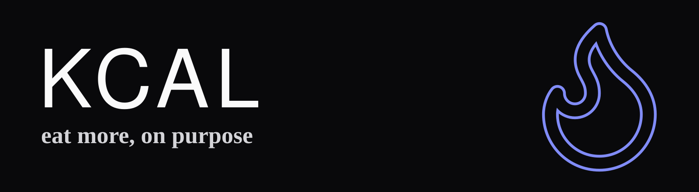

<a href="https://kcal.avp.software"></a>

[](LICENSE)
[](https://github.com/VanPetegem/calorie-tracker/actions/workflows/ci.yml)

## What is kcal?

A fast, ad free calorie tracker for one person, built for Swiss supermarket products. Installable PWA on
SvelteKit 3, Cloudflare Workers and D1, running for free on the Cloudflare free plan.

Live at [kcal.avp.software](https://kcal.avp.software) (single account, sign up is closed).

## Features

- **Barcode scanning** of Swiss products (Lidl, Aldi Suisse, Migros) through Open Food Facts, with the Swiss Food
  Composition Database (BLV) for generic foods. A missing product is added once and found every time after.
- **Nutrition label photos:** snap the label and Claude reads kcal and macros into the form.
- **Recipes and meal prep batches:** log "1.5 portions" or "200 g" of a cooked batch and kcal and macros fill in.
- **Adaptive targets:** evidence based daily calorie and macro targets that follow the real weight trend.
- **Weight tracking** with a smoothed trend.
- **Passkey sign in**, one year sessions, works offline as an installed app.
- **Weekly backups** of all data to R2, on top of D1 Time Travel.

## Stack

| Concern | Choice                                                                    |
| ------- | ------------------------------------------------------------------------- |
| App     | SvelteKit 3, Svelte 5 runes, TypeScript strict, Tailwind CSS 4            |
| Data    | Cloudflare D1 (SQLite) with Drizzle ORM                                   |
| Hosting | Cloudflare Workers with static assets, R2 for backups, cron trigger       |
| Auth    | Better Auth with passkeys, single account                                 |
| AI      | Claude API for nutrition label photos                                     |
| Tests   | Vitest (unit and server), Playwright (WebKit iPhone and desktop Chromium) |
| CI      | GitHub Actions: types, lint, tests, e2e, `pnpm audit`, gitleaks, CodeQL   |

## Run locally

Needs Node 22.17 or newer and pnpm.

```sh
cp .env.example .env     # set BETTER_AUTH_SECRET (openssl rand -base64 32)
pnpm install
pnpm db:migrate:local    # creates the local D1 database under .wrangler/
pnpm dev                 # http://localhost:5173
```

`pnpm verify` runs the full gate: types, lint, unit tests and e2e (run `pnpm e2e:install` once first).

## Self hosting

kcal is built for one account per deployment: the first sign up creates it and closes sign up for good. To run your own:

1. Create the Cloudflare resources: `pnpm wrangler d1 create kcal` and `pnpm wrangler r2 bucket create kcal-backups`.
2. In `wrangler.jsonc`, replace `database_id` with yours, and replace the `routes` domain and `vars.ORIGIN` with your
   domain. Update `ORIGIN` in the `deploy` job of `.github/workflows/ci.yml` too.
3. Set the Worker secrets: `pnpm wrangler secret put BETTER_AUTH_SECRET`, `OFF_CONTACT_EMAIL` (Open Food Facts
   requires a contact) and `ANTHROPIC_API_KEY` (only needed for label photos).
4. Deploy with `pnpm db:migrate:remote && pnpm build && pnpm wrangler deploy`, or add `CLOUDFLARE_API_TOKEN` and
   `CLOUDFLARE_ACCOUNT_ID` as GitHub secrets and let CI deploy on every push to `main`.
5. Open your domain and sign up with a passkey.

Details on required token permissions, migrations and backups are in [docs/architecture.md](docs/architecture.md).

## Docs

- [Architecture](docs/architecture.md): request flow, data model, service worker, deploy and secrets
- [Decisions](docs/decisions.md): why things are the way they are
- [Design spec](docs/superpowers/specs/2026-11-04-calorie-tracker-design.md) and the per phase specs and plans

## Data sources

Food data from [Open Food Facts](https://world.openfoodfacts.org) (ODbL) and the
[Swiss Food Composition Database](https://naehrwertdaten.ch) (BLV). The BLV foods are imported as SQL migrations
(`drizzle/0003_blv_foods_01.sql` to `0017_blv_foods_15.sql`, BLV version 7.1); that data is not covered by the MIT
license and stays subject to the BLV's terms of use, which require citing the source.

## License

Code under the [MIT](LICENSE) license © Arthur Van Petegem. Food data under its sources' terms, see above.
